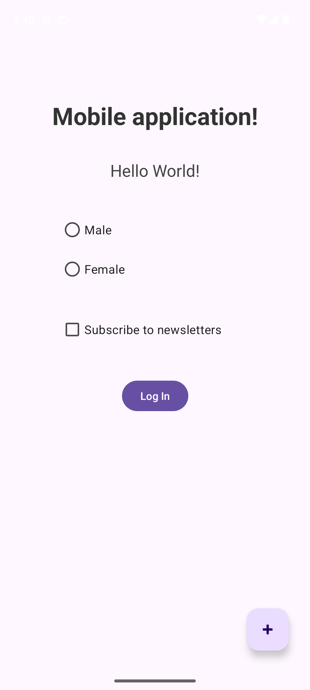
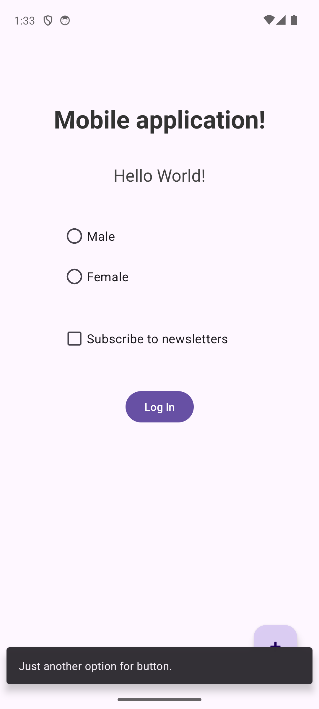
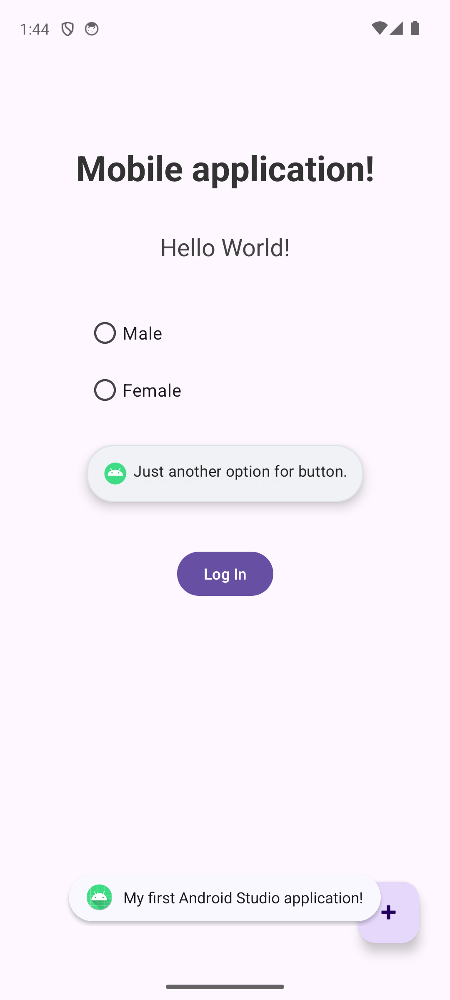

# Prva mobilna aplikacija

Preprosta začetna Android aplikacija, narejena pri predmetu MOAp. Namen naloge je spoznavanje osnovnih funkcij razvojnega okolja Android Studio.

## Opis aplikacije

Aplikacija vsebuje naslednje elemente uporabniškega vmesnika:
- Naslov **Mobile application!** in podnaslov **Hello World!**.
- Dva radio gumba (**Male** in **Female**) za izbiro spola.
- Potrditveno polje za prijavo na novice (**Subscribe to newsletters**).
- Gumb za prijavo (**Log In**), ki ob kliku prikaže kratko obvestilo (Toast) z besedilom `My first Android Studio application!`.
- Lebdeči gumb (**FAB**), ki ob kliku prikaže obvestilo (Snackbar) z besedilom `Just another option for button.`.

Vsa besedila v aplikaciji so shranjena v `strings.xml`.

## Posnetki aplikacije
| Glavni zaslon | Snackbar | Snackbar 2 ter Toast |
| --- | --- | --- |
|  |  |  |
